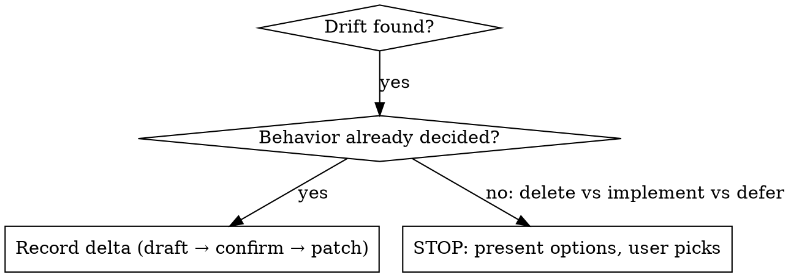

## Local Overrides (hub agentic-os-core)

- Root `docs/superpowers/`, spec là mọi file trong `specs/`. Patch tại chỗ, không CLI openspec, không delta/main split.
- Approved spec only: chưa approve → `/spec`; feature/kiến trúc mới → `/intent`.
- Planning artifacts only — never code, tests, `DESIGN.md`, `PRODUCT.md`, config.
- Prose tiếng Việt, terms English. SKILL.md local thắng `.templates/spec/OpenSpec/`.

# Updating Specs (delta + back-sync)

## Overview

Việc mới → code theo spec (gate chain); drift đã ship → spec theo code (skill này). Back-sync ghi lại thực tế, không phê duyệt hành vi mới.

## When to Use

- Spec ghi X, code làm Y (contract, flow, validation, error, routing, sort)
- Hotfix đã merge cần ghi vào spec
- Nhánh chết vi phạm anti-goal cần ghi nhận + follow-up

When NOT to use: feature/kiến trúc mới → `/intent`; spec chưa approve → `/spec`; sửa code/test/design; drift copy/layout (loại, không patch).

## Core Pattern

Mỗi thay đổi là hunk dán nhãn + danh sách loại trừ:

```markdown
- MODIFIED §3: callback lỗi → `302 /?auth=<reason>` (giữ scenario cũ)
- ADDED §5: notice `?auth` (`role=status`, reason lạ render nothing)
- REMOVED: —
- UI-only (không patch): trigger 32px vs 24px — sizing, không đổi contract
```

## Decision



## Workflow

1. **Select spec.** Ưu tiên path user đưa; trống thì list `docs/superpowers/specs/` và hỏi. Announce `Using spec: <path>`.
2. **Get drift.** Base = commit lúc spec approved (`git log -- <spec-path>`), rồi `git diff <base>..HEAD -- apps/`. Change user mô tả vẫn phải đối chiếu code.
3. **Classify.** Behavior vào spec; UI-only liệt kê kèm lý do, không patch.
4. **Draft in conversation, reconcile all.** Đọc spec + intent/plan/ADR liên quan; check 2 chiều (`MODIFIED` giữ scenario cũ). Chưa ghi file.
5. **Confirm, then write — one spec.** Show hunk + why; confirm mới ghi, reject thì bỏ. Viết xong đọc lại, quét note mới vs text cũ.
6. **Point next (guidance only).** Architecture → `/adr` số mới; còn lại → `/verify`; feature mới → `/intent`. STOP sau khi user accept patch — không tự chạy gate tiếp theo.

## Guardrails

- Planning artifacts only — never code, tests, `DESIGN.md`, `PRODUCT.md`, config.
- Never rewrite pinned tests to match your decision.
- Never silently decide load-bearing calls — present options, user picks.
- One spec per invocation. Không bịa behavior ngoài diff/code.

## Rationalizations

| Excuse | Reality |
|---|---|
| "Làm nhanh, khỏi confirm" | Draft + confirm rẻ hơn revert. |
| "Spec đã gợi ý xóa, cứ xóa" | Gợi ý không phải duyệt. Present options. |
| "Tiện tay sửa code/design" | Scope creep. Code là gate khác. |
| "Test pin sai, sửa luôn" | Test đổi chỉ qua test gates. |
| "Một dòng thôi, confirm thừa" | Một dòng sai file tốn hơn một câu hỏi. |

## Red Flags — STOP, go back to step 4

- Chuẩn bị `Edit`/`Write` trước khi user confirm hunk
- "Xóa hay implement cũng được, chọn giùm"
- Tay chạm `apps/`, `DESIGN.md`, `PRODUCT.md`, `*.test.*`
- "Viết lại cả file cho gọn"

## Common Mistakes

- Viết lại cả file thay vì hunk dán nhãn
- Note mới mâu thuẫn text cũ (quên reconcile + đọc lại)
- Nhét copy/layout vào spec; bịa behavior ngoài diff
- Path `openspec/` hay CLI openspec (hub không có)
